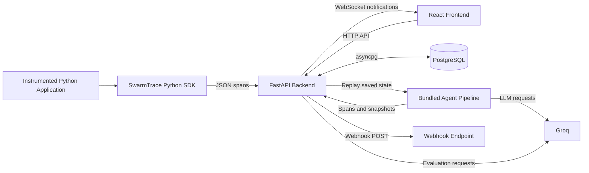

# SwarmTrace

**Trace, inspect, and investigate AI agent execution.**

SwarmTrace is an AI agent observability and debugging platform that helps developers understand what happens inside multi-agent workflows. It records agent inputs, outputs, parent-child relationships, execution latency, and token usage, allowing developers to investigate runs beyond traditional application logs.

Its web dashboard provides trace exploration, execution trees, span inspection, snapshot-based replay, and LLM-powered evaluation in one interface.

SwarmTrace is designed for developers building AI agent pipelines who need to identify which step produced an unexpected result, inspect the information passed between agents, and investigate the impact of changes.

General agent instrumentation is available through the Python SDK. Replay currently targets the bundled researcher → writer → critic pipeline.

## Key Features

- **Observability Dashboard:** Monitor trace counts, success rate, average latency, estimated cost, and daily execution activity.
- **Trace Explorer:** Browse traces, select projects, search by trace ID, and filter by status or root agent.
- **Execution Trees:** Visualize parent-child span relationships with an interactive graph, zoom controls, and minimap.
- **Span Inspection:** Inspect individual agent inputs, outputs, execution details, and output overrides.
- **Trace Investigation:** View execution status, latency, estimated cost, and relationships between original and forked traces.
- **Snapshot-Based Replay:** Modify saved execution state, create a linked fork, and resume downstream steps in the bundled agent pipeline.
- **LLM Evaluation:** Evaluate agent reasoning spans using a Groq-hosted judge and inspect relevance, reasoning, quality, overall scores, feedback, and verdicts.
- **Authentication and Project Management:** Register, sign in, create projects, and manage project-scoped API keys.
- **Webhook Alerts:** Configure webhook notifications for supported failure and loop events.
- **Additional Backend APIs:** Project membership, retention policies, audit logging, billing-plan metadata, and OTLP JSON export.

Some backend capabilities do not have dedicated frontend pages. See [Current Limitations](#current-limitations) for implementation boundaries.

## Architecture

The application consists of a React frontend, FastAPI backend, PostgreSQL database, and Python SDK.

The frontend communicates with the backend through HTTP APIs and WebSockets. The SDK sends application-specific JSON spans to the ingestion endpoint. The bundled agents additionally submit execution snapshots, which are used by the replay workflow.

Agent execution and evaluation use Groq. Configured alerts send outbound HTTP POST requests.



Tracing uses custom JSON ingestion and OTel-inspired span relationships. The SDK and backend span helper do not initialize the official OpenTelemetry SDK. OTLP JSON is generated through the export API; an OpenTelemetry collector is not included.

## Technology Stack

| Area | Technologies |
|---|---|
| Frontend | React 19, React Router 7, Vite 8, Tailwind CSS 4, Axios, React Flow |
| Backend | Python 3.12+, FastAPI, Uvicorn, Pydantic, HTTPX |
| Database | PostgreSQL, asyncpg |
| Agent execution | LangChain Groq integration |
| Evaluation | Groq client |
| Authentication | bcrypt, python-jose, HS256 JWT |
| Observability | Custom span and snapshot ingestion, WebSockets, token-based cost estimates, OTLP JSON export |
| Python SDK | Python 3.10+, HTTPX, Hatchling |
| Infrastructure | Docker Compose, Render configuration |
| Testing and tooling | pytest, pytest-asyncio, pytest-mock, Ruff, Oxlint |

Dependency declarations:

- `backend/pyproject.toml`
- `backend/requirements.txt`
- `frontend/package.json`
- `sdk/pyproject.toml`

## Project Structure

```text
SwarmTrace/
├── backend/
│   ├── main.py
│   ├── database.py
│   ├── models.py
│   ├── auth/
│   ├── agents/
│   ├── tracing/
│   ├── routers/
│   ├── alerting.py
│   ├── tests/
│   ├── pyproject.toml
│   ├── requirements.txt
│   └── Dockerfile
│
├── frontend/
│   ├── src/
│   │   ├── main.jsx
│   │   ├── App.jsx
│   │   ├── api/
│   │   ├── pages/
│   │   └── components/
│   ├── tests/
│   ├── package.json
│   └── vite.config.js
│
├── sdk/
│   ├── swarmtrace/
│   └── pyproject.toml
│
├── docs/
│   └── project-authorization.md
│
├── landing/
├── docker-compose.yml
├── docker-compose.env.example
└── render.yaml
```

## Getting Started

### Prerequisites

- Git
- Python 3.12 or newer for the backend
- Python 3.10 or newer for the standalone SDK
- Node.js 20.19+ (20.x) or 22.12+, and npm
- PostgreSQL database, or Docker with Docker Compose
- Groq API key for bundled agent execution, replay, and evaluation

### 1. Clone the Repository

```bash
git clone https://github.com/aayushi-sing/SwarmTrace.git
cd SwarmTrace
```

### 2. Configure Backend Environment

Create a file named `backend/.env`.

```dotenv
DATABASE_URL=postgresql://<db-user>:<db-password>@<db-host>:5432/<db-name>
JWT_SECRET_KEY=<your-long-random-secret>
GROQ_API_KEY=<your-groq-api-key>
INGEST_URL=http://localhost:8000/ingest
```

Replace the placeholders with your own values.

| Variable | Purpose |
|---|---|
| `DATABASE_URL` | PostgreSQL connection string |
| `JWT_SECRET_KEY` | JWT signing and verification |
| `GROQ_API_KEY` | Bundled agent execution and LLM evaluation |
| `INGEST_URL` | Backend ingestion URL used by the bundled span emitter |
| `SWARMTRACE_API_KEY` | Project API key used by the bundled span emitter |
| `VITE_API_URL` | Frontend backend origin; defaults to `http://localhost:8000` |

Keep environment files and credentials out of source control.

Use the SSL settings required by your database provider when configuring `DATABASE_URL`.

### 3. Start the Backend

From the repository root:

**Windows CMD**

```cmd
cd backend
py -3.12 -m venv .venv
.venv\Scripts\activate.bat
python -m pip install -r requirements.txt
python -m uvicorn main:app --host 127.0.0.1 --port 8000 --reload
```

**Linux / macOS**

```bash
cd backend
python3.12 -m venv .venv
source .venv/bin/activate
python -m pip install -r requirements.txt
python -m uvicorn main:app --host 127.0.0.1 --port 8000 --reload
```

Run the backend from the `backend/` directory so local imports and environment-file discovery work as expected.

The backend starts at:

- API: `http://127.0.0.1:8000`
- Health endpoint: `http://127.0.0.1:8000/health`
- Interactive API documentation: `http://127.0.0.1:8000/docs`
- OpenAPI schema: `http://127.0.0.1:8000/openapi.json`

The health endpoint returns application metadata; it does not verify database readiness.

### 4. Start the Frontend

Open a second terminal.

```bash
cd frontend
npm ci
npm run dev
```

Open:

`http://localhost:5173`

Register an account and use Settings to create a project and an API key.

If your backend runs at a different origin, create `frontend/.env.local`:

```dotenv
VITE_API_URL=http://localhost:8000
```

Restart the Vite development server after changing frontend environment variables.

The frontend uses an absolute backend URL. WebSocket URLs are derived from that setting. Ensure the backend CORS configuration allows your frontend origin.

### 5. Produce a Trace

Create a project in Settings and generate a project API key.

For the standalone SDK, follow the [SDK Usage](#sdk-usage) instructions.

To run the bundled agent pipeline, add the project key to `backend/.env`:

```dotenv
SWARMTRACE_API_KEY=<your-project-api-key>
```

Restart the backend.

From the `backend/` directory, with the virtual environment activated:

```bash
python -m agents.orchestrator
```

This runs the bundled agent pipeline and may make requests to Groq, potentially incurring provider charges.

The bundled agent and judge model identifiers are configured in source code. Their availability depends on your Groq account and requires runtime verification.

## Docker Setup

The checked-in Docker Compose configuration provides PostgreSQL and the backend. The frontend must be started separately.

From the repository root, copy the environment template.

**Windows CMD**

```cmd
copy docker-compose.env.example .env
```

**Linux / macOS**

```bash
cp docker-compose.env.example .env
```

Edit the root `.env` file and provide your own:

```dotenv
GROQ_API_KEY=<your-groq-api-key>
JWT_SECRET_KEY=<your-long-random-secret>
```

Start the services:

```bash
docker compose up --build -d
```

View backend logs:

```bash
docker compose logs -f backend
```

Stop the services:

```bash
docker compose down
```

The PostgreSQL data is persisted in the `postgres_data` volume.

**Docker configuration notes:**

- Compose currently uses fixed local database credentials. Treat this configuration as local development infrastructure.
- PostgreSQL is published on the host.
- The backend service does not automatically receive `SWARMTRACE_API_KEY` through the current Compose configuration. Backend-internal span emission and replay therefore need additional environment wiring.
- Do not reuse local Compose credentials in a public or production deployment.

## Python SDK Usage

The Python SDK allows applications to submit spans to SwarmTrace.

Install the package from the repository root:

```bash
python -m pip install -e ./sdk
```

Create a project API key in Settings and configure it in your environment.

```dotenv
SWARMTRACE_API_KEY=<your-project-api-key>
SWARMTRACE_BASE_URL=http://localhost:8000
```

Example:

```python
import os

from swarmtrace import SwarmTracer

tracer = SwarmTracer(
    api_key=os.environ["SWARMTRACE_API_KEY"],
    base_url=os.environ.get(
        "SWARMTRACE_BASE_URL",
        "http://localhost:8000",
    ),
)

with tracer.span(
    "orchestrator",
    input_payload={"task": "summarize a document"},
) as root:

    with tracer.span(
        "summarizer",
        parent_span_id=root.span_id,
        input_payload={"text": "Example document"},
    ) as child:

        child.set_output({"summary": "Example summary"})
        child.set_token_usage(
            prompt_tokens=20,
            completion_tokens=5,
        )

    root.set_output({"status": "finished"})

print(tracer.trace_id)
```

A `SwarmTracer` instance shares one trace ID across its spans. Construct a new instance for a new run or pass a trace ID explicitly.

Parent-child relationships are created using `parent_span_id`.

Supported span types include:

- `AGENT_REASONING`
- `TOOL_EXECUTION`
- `HANDOFF`

The SDK also provides asynchronous spans, a tracing decorator, and an `enabled=False` option.

**SDK limitations:**

- The SDK does not automatically create state snapshots.
- It does not automatically mark traces complete.
- Failed span delivery is logged but not queued or retried.
- Snapshot-based replay requires snapshots supplied through ingestion.

See `sdk/swarmtrace/tracer.py` and `sdk/swarmtrace/_http.py` for implementation details.

## API Overview

The following endpoints are based on the current backend implementation. For complete request and response schemas, use `/docs` while the backend is running.

### Authentication, Projects, and API Keys

| Method | Endpoint | Purpose |
|---|---|---|
| POST | `/auth/register` | Register an account |
| POST | `/auth/login` | Sign in |
| GET | `/auth/me` | Retrieve the authenticated user's profile |
| GET / POST | `/projects` | List or create projects |
| GET / DELETE | `/projects/{project_id}` | Retrieve or delete a project |
| GET / POST | `/api-keys` | List or create API keys |
| DELETE | `/api-keys/{key_id}` | Revoke an API key |
| GET / POST | `/projects/{project_id}/members` | List or add project members |
| PATCH / DELETE | `/projects/{project_id}/members/{member_id}` | Update or remove a member |

### Tracing, Replay, Evaluation, and Export

| Method | Endpoint | Purpose |
|---|---|---|
| GET | `/health` | Service health metadata |
| POST | `/ingest` | Submit spans and optional snapshots |
| GET | `/traces` | List traces |
| GET | `/trace/{trace_id}` | Retrieve trace details and span tree |
| PATCH | `/traces/{trace_id}/complete` | Complete a trace |
| GET | `/metrics` | Retrieve dashboard metrics |
| POST | `/replay` | Replay a saved snapshot |
| POST | `/evaluate/{trace_id}` | Evaluate reasoning spans |
| GET | `/evaluations/{trace_id}` | Retrieve evaluation results |
| GET | `/export/otlp/{trace_id}` | Generate OTLP JSON |
| GET | `/export/otlp/{trace_id}/download` | Download OTLP JSON |
| WebSocket | `/ws/traces` | Global trace notifications |
| WebSocket | `/ws/trace/{trace_id}` | Per-trace notifications |

The trace listing endpoint supports project, status, root-agent, search, and date filters.

### Alerts and Administration

| Method | Endpoint | Purpose |
|---|---|---|
| POST | `/alerts` | Create or update a webhook |
| GET / DELETE | `/alerts/{project_id}` | Retrieve or delete webhook configuration |
| GET | `/audit/{project_id}` | Retrieve audit records |
| GET / PUT | `/retention/{project_id}` | Retrieve or configure retention |
| DELETE | `/retention/{project_id}/purge` | Purge older traces |
| GET | `/billing/plans` | Retrieve plan definitions |
| GET | `/billing/{project_id}` | Retrieve project plan and usage |
| POST | `/billing/{project_id}/upgrade` | Perform a mock plan change |

**Important:** Not all backend endpoints currently enforce authentication and project-level authorization. Review the [Security](#security) section before exposing the backend publicly.

## Testing

### Backend Tests

From the `backend/` directory, with the virtual environment activated:

```bash
python -m pytest tests -v -p no:cacheprovider
```

The backend tests use mocked database pools, HTTP calls, and replay execution. They cover areas including database behavior, ingestion, trace queries, authorization, and replay.

These tests are not a substitute for live integration testing. In particular, the test client does not run the complete application startup lifecycle.

### Frontend Checks

From the `frontend/` directory:

```bash
npm run lint
npm run build
```

The repository contains files under `frontend/tests/`, including browser smoke and component-related checks. These are not exposed through a standard `npm test` script in the current package configuration. Check the individual test files for their execution requirements before running them.

### Live Verification

End-to-end workflows require running services.

The following require additional runtime configuration:

- Registration and authentication
- SDK ingestion
- Trace exploration
- Snapshot replay
- Groq-powered evaluation
- WebSocket notifications
- Outbound webhook delivery

Replay and evaluation require a working Groq API key and accessible models. Webhook testing requires a reachable endpoint.

Use a disposable local database and project for live testing.

## Deployment

The checked-in `render.yaml` describes a backend-only Render web service.

### Backend Deployment on Render

1. Push the repository to GitHub.
2. Create a new Web Service on Render.
3. Connect the `aayushi-sing/SwarmTrace` repository.
4. Set the root directory to `backend`.
5. Use the configured Python build and start commands.

The current blueprint specifies:

**Build command**

```bash
pip install -r requirements.txt
```

**Start command**

```bash
uvicorn main:app --host 0.0.0.0 --port $PORT
```

Configure the required environment variables in Render:

| Variable | Description |
|---|---|
| `DATABASE_URL` | Hosted PostgreSQL connection string |
| `JWT_SECRET_KEY` | Strong, randomly generated JWT signing secret |
| `GROQ_API_KEY` | Groq API key |
| `INGEST_URL` | Public backend ingestion URL |
| `SWARMTRACE_API_KEY` | Project API key for bundled span emission, when required |

The current Render blueprint does not provision PostgreSQL automatically. A separate hosted PostgreSQL database is required.

The blueprint also does not automatically configure `JWT_SECRET_KEY` or `SWARMTRACE_API_KEY`; add them through the service's environment settings when needed.

### Frontend Deployment

The frontend must be deployed separately as a static site.

Build it from the `frontend/` directory:

```bash
npm ci
npm run build
```

The generated static files are in:

```text
frontend/dist/
```

Configure your hosting provider with:

- Build command: `npm ci && npm run build`
- Output directory: `dist`
- Environment variable: `VITE_API_URL=https://<your-backend-domain>`

Configure the backend CORS settings to allow the exact deployed frontend origin.

The frontend should use HTTPS in a public deployment. Configure the hosting provider to serve `index.html` for browser-side routes.

**Deployment status:** These instructions describe the checked-in deployment configuration. They do not claim that a public deployment has already been completed or verified.

## Security

SwarmTrace includes authentication and project-management functionality, but the current implementation has important security limitations.

- **Passwords and sessions:** Passwords are hashed with bcrypt. JWTs use HS256 and have a seven-day expiry. Browser sessions store bearer tokens in `localStorage`.
- **API keys:** Project API keys are generated using cryptographically random bytes. The current implementation stores full key values in the database, so database access must be treated as access to those credentials.
- **Project roles:** Some membership, retention, billing, and audit endpoints use viewer/admin role checks.
- **Authorization gaps:** Several trace, metrics, replay, evaluation, export, and WebSocket endpoints currently lack authentication or consistent project-level authorization.
- **Webhook destinations:** Webhook URLs are user-supplied, and destination restrictions are not implemented.
- **External model requests:** Evaluation and replay can send stored prompt and output data to Groq.
- **Secret management:** Database credentials, JWT secrets, and provider API keys must be stored in environment variables or deployment secret stores. Never expose secrets through frontend `VITE_` variables.

The frontend login screen and CORS configuration do not replace backend authentication and authorization.

**Do not expose this backend to untrusted public traffic or store sensitive user data until the access-control and credential-storage issues have been addressed and verified.**

## Current Limitations

- **Replay scope:** Replay depends on saved snapshots and the state fields used by the bundled pipeline. It is not a generic mechanism for resuming arbitrary Python applications.
- **SDK snapshots:** The standalone SDK records spans but does not automatically create replay snapshots or complete traces.
- **Trace browsing:** Trace listing is limited to the latest 100 matching traces and does not currently provide pagination.
- **Live updates:** WebSocket clients do not implement automatic reconnection.
- **Evaluation:** Previously evaluated spans are skipped even when the UI displays a re-evaluation action. Judge inputs and outputs are truncated.
- **Cost estimates:** Costs use fixed token-price estimates rather than reconciliation with provider billing.
- **Alerts:** Webhook delivery does not have a retry queue.
- **Administration:** Membership, audit, retention, export, and billing capabilities do not all have dedicated frontend pages.
- **Billing:** Plan changes are mocked. Payment processing is not implemented, and plan limits are not enforced during ingestion.
- **Retention:** Retention cleanup runs during startup or through an explicit purge request; there is no scheduled background task.
- **Testing:** Live deployment, external model workflows, and end-to-end behavior require separate runtime verification.

## License

This repository should retain the original MIT license notice and copyright attribution before public distribution. See the root `LICENSE` file.