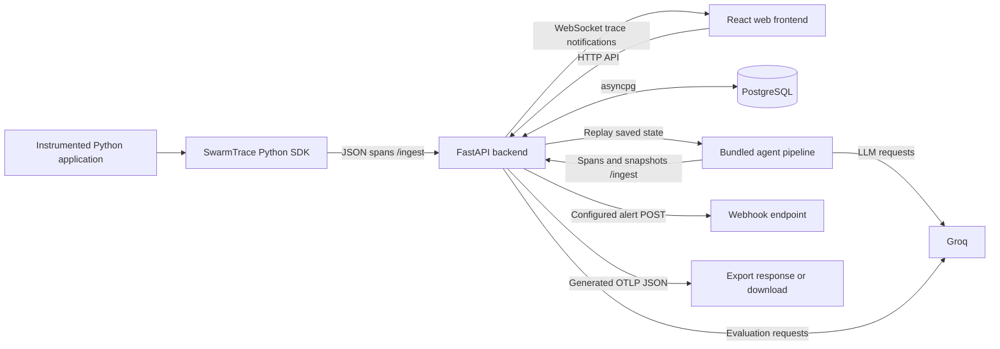

# SwarmTrace

**Trace, inspect, and investigate AI agent execution.**

SwarmTrace records agent inputs, outputs, parent-child relationships, latency, and token usage so developers can follow a multi-agent run beyond flat application logs. Its web dashboard brings trace exploration, execution trees, snapshot-based replay, and LLM evaluation into one workflow.

It is intended for developers building AI agent pipelines who need to identify which step produced an unexpected result, inspect the data passed between agents, and compare the outcome of a controlled change. General agent instrumentation is available through the Python SDK; replay currently targets the bundled researcher → writer → critic pipeline.

[Getting started](#getting-started) · [Docker setup](#docker-setup) · [SDK usage](#sdk-usage) · [API overview](#api-overview) · [Current limitations](#current-limitations)

## Key features

- **Dashboard:** trace counts, success rate, average latency, estimated cost, and daily activity over the last seven days.
- **Trace exploration:** select a project, search by trace ID, and filter by status or root agent. Trace notifications refresh the dashboard over WebSocket.
- **Execution trees:** inspect parent-child span relationships in an interactive React Flow graph with zoom controls and a minimap. Select a span to inspect its input and edit an output override.
- **Trace details:** view execution status, latency, estimated cost, and links to a fork's parent trace.
- **Snapshot replay:** merge overrides into a saved state, create a linked fork, and resume downstream steps in the bundled pipeline. Compare original and forked outputs, latency, and cost side by side.
- **Evaluation:** run a Groq-hosted judge on unevaluated `AGENT_REASONING` spans and view relevance, reasoning, quality, overall scores, feedback, and verdicts.
- **Accounts and project settings:** register or sign in, create and delete projects, issue and revoke project-scoped ingestion API keys, and configure failure/loop webhooks.
- **Additional backend APIs:** project membership roles, retention policies, best-effort audit logging, and generated OTLP JSON exports. These capabilities do not have dedicated pages in the current frontend.

Implementation boundaries and access-control gaps are documented under [Security](#security) and [Current limitations](#current-limitations). Features described here are established from source inspection; external-service workflows still require a configured environment to verify end to end.

## Screenshots

Screenshots of the redesigned interface will be added soon.

## Architecture

The React frontend calls a FastAPI backend through Axios and subscribes to trace notifications. FastAPI stores users, projects, keys, traces, spans, snapshots, evaluations, and configuration in PostgreSQL through an asynchronous `asyncpg` pool.

The Python SDK sends application-specific JSON spans to `/ingest`. The bundled agents use a separate lightweight span helper that also submits state snapshots. Replay loads those snapshots and invokes the bundled orchestrator. Agent execution and evaluation call Groq; configured alerts send outbound HTTP POST requests.



Tracing uses custom JSON ingestion and OTel-inspired span relationships. Neither the local SDK nor the backend span helper initializes the official OpenTelemetry SDK. OTLP is generated on export; no collector service is included.

## Technology stack

| Area | Technologies in this repository |
| --- | --- |
| Frontend | React 19, React Router 7, Vite 8, Tailwind CSS 4, Axios, `@xyflow/react` |
| Backend | Python 3.12+, FastAPI, Uvicorn, Pydantic, HTTPX |
| Database | PostgreSQL, `asyncpg`; PostgreSQL 16 in Compose; a hosted PostgreSQL URL can also be supplied |
| Agent execution and evaluation | LangChain Groq integration for bundled agents; Groq client for evaluations; LangGraph is declared as a dependency, while the bundled orchestrator calls agents sequentially |
| Authentication | bcrypt password hashing, `python-jose` HS256 JWTs, project-scoped API keys |
| Observability | Custom span/snapshot ingestion, WebSockets, token-based cost estimates, OTLP JSON export |
| Python SDK | Python 3.10+, HTTPX, Hatchling packaging |
| Tooling and infrastructure | pytest, pytest-asyncio, pytest-mock, Ruff, Oxlint, Docker Compose, Render backend blueprint |

Dependency declarations are in [backend/pyproject.toml](backend/pyproject.toml), [backend/requirements.txt](backend/requirements.txt), [frontend/package.json](frontend/package.json), and [sdk/pyproject.toml](sdk/pyproject.toml).

## Project structure

```text
SwarmTrace/
├── backend/
│   ├── main.py                 # FastAPI app, CORS, schema setup, startup retention
│   ├── database.py             # Connection pool and core database schema
│   ├── models.py               # Ingestion, trace, and replay payloads
│   ├── auth/                   # JWT, password hashing, API keys, role dependencies
│   ├── agents/                 # Orchestrator, researcher, writer, critic
│   ├── tracing/otel_setup.py   # Lightweight span and snapshot emitter
│   ├── routers/                # Auth, traces, replay, evaluation, settings APIs
│   ├── alerting.py             # Outbound webhook delivery
│   ├── tests/                  # Mock-based backend tests
│   ├── pyproject.toml
│   ├── requirements.txt
│   └── Dockerfile
├── frontend/
│   ├── src/
│   │   ├── main.jsx            # React root and StrictMode
│   │   ├── App.jsx             # Routes and browser login gate
│   │   ├── api/client.js        # Axios client and WebSocket factories
│   │   ├── pages/              # TraceList, TraceDetail, TraceDiff, Login, Settings
│   │   └── components/         # SpanTree, SpanNode, ReplayPanel
│   ├── package.json
│   └── vite.config.js
├── sdk/
│   ├── swarmtrace/             # SwarmTracer, Span, sync/async HTTP transport
│   └── pyproject.toml
├── docs/screenshots/           # Historical UI images; not used in this README
├── landing/index.html          # Separate static landing page
├── docker-compose.yml
├── docker-compose.env.example
└── render.yaml                 # Backend service deployment
```

## Getting started

### Prerequisites

- Git.
- Python **3.12+** for the backend. The standalone SDK supports Python **3.10+**.
- Node.js **20.19+ within the 20.x line, or 22.12+**, matching the installed Vite package's engine declaration, and npm.
- A reachable PostgreSQL database and a database user allowed to create tables and alter the schema. Compose provides a local database if preferred.
- A Groq API key for bundled agent runs, replay that executes agents, and evaluations. Browsing existing traces and ingesting SDK spans do not themselves call Groq.
- Docker with Compose support for the [Docker setup](#docker-setup), optionally Docker Desktop on Windows.

### Clone the repository

These commands work in a general shell and Windows CMD:

```sh
git clone https://github.com/codewithleo1/SwarmTrace.git
cd SwarmTrace
```

### Configure the backend environment

Create `backend/.env` locally with the following template. Replace all angle-bracket placeholders; they are not working credentials. The current working tree does not contain `backend/.env.example`, so there is no backend template-copy step.

```dotenv
DATABASE_URL=postgresql://<db-user>:<db-password>@<db-host>:5432/<db-name>
JWT_SECRET_KEY=<your-long-random-secret>
GROQ_API_KEY=<your-groq-api-key>
INGEST_URL=http://localhost:8000/ingest
```

Use the SSL settings required by your database provider in `DATABASE_URL`. Keep secrets in local environment files or your deployment's secret store, and do not commit populated files.

| Variable | Where it is used |
| --- | --- |
| `DATABASE_URL` | Backend PostgreSQL pool; required for application startup |
| `JWT_SECRET_KEY` | JWT signing and verification; explicitly set it to avoid the insecure source fallback |
| `GROQ_API_KEY` | Bundled agents and evaluation judge |
| `INGEST_URL` | Bundled span emitter; also used to derive the backend URL for trace completion |
| `SWARMTRACE_API_KEY` | Bundled span emitter's `X-API-Key`; add after creating a project API key |
| `VITE_API_URL` | Frontend backend origin; defaults to `http://localhost:8000` |

`ENVIRONMENT` and `LOG_LEVEL` appear in Compose and Render configuration, but no application code was found reading them. They do not replace configuration of authentication or access control.

### Start the backend

From the repository root, in a general POSIX shell:

```sh
cd backend
python -m venv .venv
. .venv/bin/activate
python -m pip install -r requirements.txt
python -m uvicorn main:app --host 127.0.0.1 --port 8000 --reload
```

Windows CMD:

```bat
cd backend
py -3.12 -m venv .venv
.venv\Scripts\activate.bat
python -m pip install -r requirements.txt
python -m uvicorn main:app --host 127.0.0.1 --port 8000 --reload
```

Run from `backend/` so local imports and `.env` discovery match the project layout. Startup applies the schema, ensures auxiliary tables exist, and runs retention cleanup for projects with configured policies.

- Health: `http://127.0.0.1:8000/health`
- Interactive API documentation: `http://127.0.0.1:8000/docs`
- OpenAPI schema: `http://127.0.0.1:8000/openapi.json`

The health route returns application metadata; it does not perform a database readiness query.

### Start the frontend

In a second terminal, from the repository root:

```sh
cd frontend
npm ci
npm run dev
```

The same commands work in Windows CMD. Open `http://localhost:5173`, register an account, then use Settings to create a project and an API key. The demo login button requires a pre-existing demo account; normal startup does not create it.

For an explicit backend origin, create `frontend/.env.local`:

```dotenv
VITE_API_URL=http://localhost:8000
```

Use an absolute HTTP(S) backend origin: WebSocket URLs are derived from it. Restart Vite after changing the environment. The default client calls port 8000 directly, so the `/api` proxy in [vite.config.js](frontend/vite.config.js) is not used by that default configuration. The backend explicitly allows `http://localhost:5173` through CORS; `http://127.0.0.1:5173` is a different origin.

### Produce a trace

Use the [SDK example](#sdk-usage) to record your own agent steps. To run the bundled pipeline with snapshots, add your project key to `backend/.env`:

```dotenv
SWARMTRACE_API_KEY=<your-project-api-key>
```

Restart the backend so replay's emitter loads the key. In another terminal with the backend virtual environment activated, run from `backend/`:

```sh
python -m agents.orchestrator
```

This calls Groq and may incur provider charges. Agent and judge model identifiers are hard-coded in source; their availability for your Groq account requires live verification. Refresh trace details after execution to inspect the completed tree.

## Docker setup

[Docker Compose](docker-compose.yml) defines **PostgreSQL and the backend only**. Run the frontend separately with npm.

From the repository root, copy the Compose environment template:

```sh
cp docker-compose.env.example .env
```

Windows CMD equivalent:

```bat
copy docker-compose.env.example .env
```

Edit the new root `.env` and supply your own `GROQ_API_KEY` and `JWT_SECRET_KEY`. Then:

```sh
docker compose up --build -d
docker compose logs -f backend
```

The backend is exposed on port 8000 and PostgreSQL on port 5432. Database state persists in the `postgres_data` volume. Compose supplies the backend database URL and waits for PostgreSQL's health check before starting the backend.

Stop the services while retaining the database volume:

```sh
docker compose down
```

Compose currently declares fixed local database credentials and publishes PostgreSQL to the host. Treat this configuration as local development infrastructure. No credentials from that configuration are reproduced here.

**Replay caveat:** the Compose backend environment does not forward `SWARMTRACE_API_KEY`. Adding that variable to the root `.env` alone will not pass it into the container. Backend-internal span emission requires that variable to be explicitly supplied to the backend service; the checked-in Compose setup does not complete that wiring. An external SDK can still send an API key in its ingestion requests.

## SDK usage

Install the checked-in Python package from the repository root, using your active Python environment:

```sh
python -m pip install -e ./sdk
```

Create a project API key in Settings. Set it as `SWARMTRACE_API_KEY` in the environment of the process running this example. Configure `SWARMTRACE_BASE_URL` only if your backend is elsewhere; the example reads that variable explicitly.

```python
import os

from swarmtrace import SwarmTracer

tracer = SwarmTracer(
    api_key=os.environ["SWARMTRACE_API_KEY"],
    base_url=os.environ.get("SWARMTRACE_BASE_URL", "http://localhost:8000"),
)

with tracer.span("orchestrator", input_payload={"task": "summarize a document"}) as root:
    with tracer.span(
        "summarizer",
        parent_span_id=root.span_id,
        input_payload={"text": "Example document"},
    ) as child:
        child.set_output({"summary": "Example summary"})
        child.set_token_usage(prompt_tokens=20, completion_tokens=5)
    root.set_output({"status": "finished"})

print(tracer.trace_id)
```

A `SwarmTracer` instance shares one trace ID across its spans; construct a new instance for a new run or pass `trace_id` explicitly. Parent relationships are explicit through `parent_span_id`. Supported span types are `AGENT_REASONING`, `TOOL_EXECUTION`, and `HANDOFF`.

The SDK also provides `async with tracer.async_span(...)`, a synchronous `@tracer.trace(...)` decorator, and `enabled=False` to suppress emission. The context managers post a span when they exit; delivery failures are logged without raising into the instrumented application. They do not queue or retry failed deliveries.

The SDK does **not** create state snapshots or mark traces complete automatically. The example records spans but leaves the trace status running. Completion is a separate `PATCH /traces/{trace_id}/complete` call. Snapshot replay requires snapshots supplied through `/ingest`, as the bundled agents do.

See [sdk/swarmtrace/tracer.py](sdk/swarmtrace/tracer.py) and [sdk/swarmtrace/_http.py](sdk/swarmtrace/_http.py) for the actual API and transport behavior. Installation from a published package registry is not assumed here.

## API overview

Paths below are relative to the backend origin. For request schemas, use the running application's `/docs` or inspect [backend/routers](backend/routers).

### Accounts, projects, and keys

| Method | Path | Purpose |
| --- | --- | --- |
| POST | `/auth/register` | Register with `email`, `password`, and `name`; returns a JWT |
| POST | `/auth/login` | Sign in with `email` and `password`; returns a JWT |
| GET | `/auth/me` | Read the JWT user's profile |
| GET / POST | `/projects` | List membership projects / create a project |
| GET / DELETE | `/projects/{project_id}` | Read a membership project / delete as admin |
| GET / POST | `/api-keys` | List the user's key previews / create a key for an owned project |
| DELETE | `/api-keys/{key_id}` | Revoke the user's key |
| GET / POST | `/projects/{project_id}/members` | List members / add an already registered user as admin |
| PATCH / DELETE | `/projects/{project_id}/members/{member_id}` | Change role / remove member as admin |

### Tracing, replay, evaluation, and export

| Method | Path | Purpose |
| --- | --- | --- |
| GET | `/health` | Static service health metadata |
| POST | `/ingest` | Submit `spans` and optional `snapshots`; accepts JWT or `X-API-Key` |
| GET | `/traces` | List the latest 100 matching traces |
| GET | `/trace/{trace_id}` | Return trace metadata and nested `span_tree` |
| PATCH | `/traces/{trace_id}/complete` | Set completion status and aggregate latency/cost; `status` defaults to `SUCCESS` |
| GET | `/metrics` | Dashboard summary and seven-day activity; optional `project_id` |
| POST | `/replay` | Fork a saved snapshot using `trace_id`, `step_number`, and `overrides` |
| POST | `/evaluate/{trace_id}` | Evaluate previously unevaluated reasoning spans |
| GET | `/evaluations/{trace_id}` | Retrieve persisted evaluation scores |
| GET | `/export/otlp/{trace_id}` | Generate an OTLP JSON response |
| GET | `/export/otlp/{trace_id}/download` | Download generated OTLP JSON |
| WebSocket | `/ws/traces` | Global `TRACE_UPDATE` notifications |
| WebSocket | `/ws/trace/{trace_id}` | Per-trace `NEW_SPAN` notifications |

`GET /traces` accepts `project_id`, `status`, `root_agent`, `search`, `from_date`, and `to_date`. Date filters exist in the API, while the current dashboard exposes project, trace ID, status, and agent controls.

For example, a replay body after the bundled researcher step can replace the saved findings:

```json
{
  "trace_id": "<existing-trace-id>",
  "step_number": 1,
  "overrides": {
    "findings": "Replacement findings for the downstream writer"
  }
}
```

Replay merges these fields into stored state and awaits downstream execution before returning the fork ID. It requires a snapshot at that step and is not a generic mechanism for resuming arbitrary Python applications.

### Alerts and administration

| Method | Path | Purpose |
| --- | --- | --- |
| POST | `/alerts` | Create or update a webhook for an owned project |
| GET / DELETE | `/alerts/{project_id}` | Read / remove the owner's webhook configuration |
| GET | `/audit/{project_id}` | Admin audit-log query; see the limitation below |
| GET / PUT | `/retention/{project_id}` | Read a retention policy / set it as admin |
| DELETE | `/retention/{project_id}/purge` | Admin-triggered removal of traces older than the configured policy |
| GET | `/billing/plans` | Read plan definitions |
| GET | `/billing/{project_id}` | Read membership-project plan and monthly usage |
| POST | `/billing/{project_id}/upgrade` | Admin mock plan change; no payment processing |

Authentication is **not consistently required across this API**. The frontend login gate does not protect backend endpoints. See [Security](#security) before exposing the backend.

## Testing

### Backend automated tests

From `backend/`, with the virtual environment and requirements installed:

```sh
python -m pytest tests -v -p no:cacheprovider
```

The requirements file includes pytest, pytest-asyncio, and pytest-mock. Existing tests cover span helpers, database pool behavior, ingestion validation, trace queries/tree responses, and replay responses. They use mock database pools, HTTP calls, and replay execution; the ASGI test client does not run the application startup lifecycle.

These tests are intended to run without a live database or Groq request. `tests/test_health.py` currently contains WebSocket router code rather than health test functions. No passing-test count or comprehensive authentication coverage is claimed.

### Frontend checks

From `frontend/`:

```sh
npm run lint
npm run build
```

These are lint/build checks, not automated UI tests. There is no frontend `test` script or checked-in frontend test suite. No dedicated SDK tests were found either.

### Live verification

End-to-end registration, ingestion, tree inspection, replay, evaluation, WebSocket delivery, and outbound alerts require running services. Replay and evaluation additionally require a working Groq key and accessible configured models; webhook delivery requires a reachable endpoint. Use a disposable local project/database for these checks. The repository does not provide a separate automated live-test command.

## Deployment

[render.yaml](render.yaml) describes a **backend-only** Render Python web service:

- Root directory: `backend`.
- Build command: `pip install -r requirements.txt`.
- Start command: `uvicorn main:app --host 0.0.0.0 --port $PORT`.
- Manually supplied values: `DATABASE_URL`, `GROQ_API_KEY`, and `INGEST_URL`.
- Declared values: `ENVIRONMENT=production` and `LOG_LEVEL=INFO`.

Use a Python 3.12+ runtime. Supply a database connection string with appropriate provider SSL settings. `INGEST_URL` must resolve to this backend's `/ingest` endpoint for emitted replay spans.

Also configure **`JWT_SECRET_KEY` explicitly**: it is consumed by the application but absent from the blueprint's environment list. For bundled span emission and replay, configure `SWARMTRACE_API_KEY` after creating a project key. Do not put either value in source control.

The blueprint does not provision PostgreSQL, a frontend service, or a recurring retention scheduler. Deploy the frontend separately: run `npm ci` and `npm run build` from `frontend/`, serve `frontend/dist`, set an absolute HTTPS `VITE_API_URL` at build time, and configure the host to serve `index.html` for browser routes. Ensure the frontend origin is explicitly allowed by backend CORS; the literal wildcard-looking origin in the source is not a general subdomain matching policy.

This README does not assert that any public deployment, model, or external collector integration is currently available. Deployment steps are derived from checked-in configuration, not a completed deployment run.

## Security

- **Passwords and sessions:** passwords are hashed with bcrypt. JWTs use HS256 with a seven-day expiry. The browser stores its bearer token in `localStorage` and clears it on an API 401 response. The route wrapper checks token presence rather than validating it itself.
- **API keys:** generated keys use cryptographically random bytes and a project association. Ingestion validates active keys and records last use. Listing returns previews, but full key values are stored in the database without hashing; treat database access as access to those credentials.
- **Project roles:** member, retention, billing, and audit routes use viewer/admin role dependencies. Project deletion checks admin membership; API-key creation and webhook configuration check project ownership. These checks do not establish uniform tenant isolation across the application.
- **Access-control gaps:** trace listing/detail, metrics, completion, replay, evaluation, OTLP export, and both WebSocket endpoints have no authentication dependency. Trace queries also do not enforce project membership. Some JWT-dependent handlers assume a non-null user although the shared dependency can return `None` for a missing token.
- **Data and external calls:** stored payloads can include sensitive prompts and outputs. Evaluation sends truncated input/output representations to Groq, and replay sends saved state-derived prompts to agent models. Webhook destinations are user-supplied URLs and receive outbound requests; no destination allowlist is implemented.
- **Secrets and exposure:** set a strong JWT signing secret and keep database, provider, and ingestion credentials out of Git. `VITE_` values are browser-visible configuration and must not contain secrets. CORS and the frontend login screen do not substitute for backend authorization.

Given these source-established gaps, restrict backend exposure to a trusted environment until access controls are completed and verified. No security certification or tenant-isolation guarantee is claimed.

## Current limitations

- **Replay scope:** saved snapshots and the bundled pipeline's state fields are required. Step 1 resumes writer and critic; step 2 resumes critic; step 3 executes no downstream agent. The SDK alone does not provide replay snapshots. Fork creation does not explicitly copy the parent's project ID.
- **Trace updates:** the dashboard refetches both traces and metrics for every global trace notification without coalescing. Filter changes recreate its socket, and neither socket factory implements reconnection. The detail page does not subscribe to the per-trace socket; graph state also initializes from spans without synchronizing later prop changes.
- **Trace browsing and comparison:** the list returns at most 100 results with no pagination. Diff matching uses agent name and selects the first match, so repeated instances of one agent are not aligned individually.
- **Evaluation:** previously evaluated spans are skipped even when the UI says “Re-evaluate.” Judge inputs and outputs are capped at 2,000 characters each; individual judge failures are stored as `ERROR` evaluations. Model availability requires live verification.
- **Costs and loop detection:** estimates use fixed token prices rather than provider billing reconciliation. Loop detection counts repeated sender/receiver handoffs within a trace; it is not general cycle analysis.
- **Alerts:** loop ingestion and explicit `FAILED` completion invoke alert delivery. Replay's direct failed-status update does not invoke that helper. Delivery has no retry queue, and its dashboard link is hard-coded to the existing hosted frontend origin.
- **Administration:** membership, audit, retention, export, and billing have no dedicated frontend pages. Audit queries currently assemble `LIMIT` before `ORDER BY`, which requires correction before relying on that endpoint. Replay audit writes use a non-UUID system user against a UUID column and may fail; audit logging is best-effort.
- **Retention and billing:** retention runs at startup or through an explicit purge request, without a scheduled background task. Billing changes are mocked; payment checkout/webhooks are not wired and ingestion does not enforce the declared plan limits.
- **Verification coverage:** frontend and dedicated SDK automated tests are absent. Docker startup, live deployment, Groq-backed workflows, redesigned UI appearance, and external OTLP collector compatibility require separate runtime verification.
